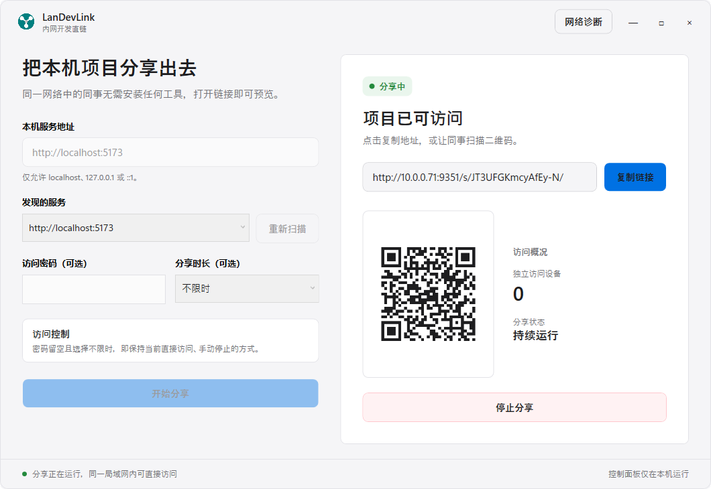

# LanDevLink 内网开发直链

> 本机开发，同网直达，让每一次预览都赢得掌声。

LanDevLink 是一款面向 Windows 的轻量级局域网开发服务分享工具。它把本机 `localhost` 服务包装成临时、可控、可撤销的访问入口，让同事、测试与产品无需配置环境，即可在同一网络中预览开发成果。

## 产品界面



## 当前能力

- 扫描常见本机开发端口，也支持手动输入服务地址
- 只允许分享 `localhost`、`127.0.0.1` 或 `::1` 服务
- 自动识别局域网 IPv4 地址和可用代理端口
- 为每次分享生成随机令牌与二维码
- 可选设置访问密码；留空时仍可直接访问
- 可选设置 15 分钟、30 分钟、1 小时或 2 小时有效期；不限时则持续运行到手动停止
- 支持 HTTP、WebSocket 与开发服务器热更新流量转发
- 可检测他人分享链接与本机是否处于同一 IPv4 子网，并探测目标端口是否可连接
- 显示本机当前活动网络连接、IPv4 地址、子网前缀和网关
- 显示独立访问设备数量和剩余时间
- 可随时停止分享，旧链接立即失效

## 使用方式

1. 先启动本机开发项目，例如 `http://localhost:5173`。
2. 打开 LanDevLink，选择检测到的服务或手动输入地址。
3. 按需设置访问密码和分享时长，然后点击“开始分享”生成局域网访问地址。
4. 点击“复制链接”手动复制地址，或让同事扫描二维码。
5. 无法打开别人分享的链接时，点击窗口顶部的“网络诊断”进入诊断界面。

访问设备必须与运行 LanDevLink 的电脑处于同一局域网。首次监听局域网端口时，Windows 可能显示防火墙提示；只需为当前可信的专用网络允许访问。

## 开发

要求 Windows 10/11 与 .NET 10 SDK。

```powershell
dotnet restore .\src\LanDevLink\LanDevLink.csproj
dotnet run --project .\src\LanDevLink\LanDevLink.csproj
```

生成免安装的 Windows x64 便携目录：

```powershell
dotnet publish .\src\LanDevLink\LanDevLink.csproj -c Release -r win-x64 --self-contained true -p:PublishSingleFile=true -p:IncludeNativeLibrariesForSelfExtract=true -o .\artifacts\win-x64
```

## 技术方案

- .NET 10 + WPF
- ASP.NET Core Kestrel
- YARP 反向代理
- QRCoder 二维码

控制界面只在本机进程中运行；对局域网开放的只有用户主动创建的代理入口。目标地址在进入代理前会被验证，避免将工具配置成任意外部网址代理。
访问密码只保存在当前进程中，不会写入配置文件；局域网访问仍使用 HTTP，因此密码仅用于访问控制，请勿复用重要账号密码。

## 当前边界

当前版本聚焦单个本机服务的局域网分享。每次分享都有随机入口地址，并可选择增加访问密码和有效期；点击“停止分享”或到达有效期后链接立即失效。公网穿透、多项目同时分享、团队账号、访问日志持久化和自动更新尚未实现。便携版不依赖管理员权限或代码签名，但未签名程序仍可能触发 Windows SmartScreen 提示。
